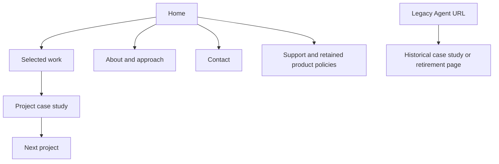

# LidlDev portfolio — redesign plan and work log

Updated: 14 October 2026, Australia/Sydney

## Working agreement

This is the running project document. Update phase status, decisions, validation, and the dated log with every implementation increment. Keep completed tasks visible and record changed plans.

- Repository: https://github.com/LidlDev/lidldev-portfolio.git
- Checkout: `Portfolio/lidldev-portfolio/`; branch: `redesign/portfolio`.
- Baseline: `main` at `01a7efd` (Adding live link to pyreus).
- Production target: https://lidldev.com, served through Cloudflare.
- Use portable project-local tools only. No Windows administrator/UAC prompts, system installers, global npm installs, machine PATH changes, or execution-policy changes.
- Portable Git lives at `../.tools/mingit/cmd/git.exe`. Tool downloads stay outside the repository.
- Retain this repository, its history, and its existing `origin` remote.
- Make small reviewable increments and record the checks for each.

Current milestone: **Local rebuild and browser QA complete. Cloudflare Pages preview/release remain pending.**

## Intended outcome

A personal projects portfolio presenting Harry / LidlDev through real work, thoughtful typography, fluid layouts, a distinct orange identity, and interactive Three.js visuals. Light and dark themes each receive complete art direction. Visitors can understand the developer, inspect a project, and make contact without an account or unrelated application.

## Existing site map

Audit evidence is the cloned source, not a verified rendering of the live domain. The available web reader could not inspect the domain. Existing copy and project statuses are outdated and need review before reuse.

| URL or section | Source | Treatment |
| --- | --- | --- |
| `/` | `src/pages/Index.tsx` | Rebuild Home → About → Projects → Skills → GitHub → Contact around selected work first |
| Navigation | `src/components/NavigationBar.tsx` | Replace with Work / About / Contact, accessible mobile menu and theme control |
| `/project/:projectId` | `src/pages/ProjectDetail.tsx` | Rebuild as a case study, retain current project IDs initially |
| `/agent` | `src/pages/Agent.tsx` | Remove embedded app and entry points; retire URL deliberately |
| `/support` | `src/pages/Support.tsx` | Retain URL, audit app-specific content |
| `/privacy`, `/terms` | Corresponding pages in `src/pages/` | Review against services retained in the portfolio |
| `/spike/privacy-policy` | `src/pages/SpikePrivacyPolicy.tsx` | Preserve product-support URL and existing substance pending review |
| `/spike/terms-of-service` | `src/pages/SpikeTermsOfService.tsx` | Preserve product-support URL and existing substance pending review |
| Unmatched routes | `src/pages/NotFound.tsx` | Branded recovery page linking back to projects |

### Project inventory

Content is in `src/data/projects.ts`; asset mappings in `src/config/images.ts`.

| ID | Project | Existing evidence and next action |
| --- | --- | --- |
| `Spike` | Spike! | Local screenshots/logo and `LidlDev/SpikeIOS` link; candidate featured project, confirm status/features |
| `Chess` | Chess App | Description and fallback imagery; remove placeholder demo and `github.com/username/chess` links, verify real assets |
| `Uncharted` | Travel discovery | Local hero/logo and `LidlDev/Uncharted` link; candidate featured project, verify screenshots/status |
| `Agent` | Agent Dashboard | Local screenshots and embedded app; remove live app, optionally retain a historical case study |
| `Pyreus` | Developer productivity | Extensive screenshots, `pyreus.dev`, `LidlDev/Pyreus`; provisional lead project, verify current links/status |

Existing `example.com` demo URLs must not ship. Existing 2024–2025 statuses and claims about AI/features need review. About cards claiming “5+ Years”, “20+” projects, “CS Degree”, and availability are unconfirmed. Use modest factual copy; never invent results, testimonials, user counts, credentials, or availability.

## Architecture findings

- React 18, TypeScript, Vite 5, React Router, Tailwind, Framer Motion and numerous Radix components. Retain React/TypeScript/Vite initially; prune unused dependencies after removal.
- `src/App.tsx` protects `/agent` with `AuthProvider` and `AuthGuard`. The portfolio does not need authentication.
- Agent includes finance, calendar, tasks, notes, projects, habits, Gmail scanning and OAuth. Trace `src/components/agent/`, `src/contexts/`, Agent hooks/services/utils, Supabase helpers/types/schema files, `api/`, and `src/pages/api/` before deleting shared code.
- Contact uses EmailJS with a direct `harry@lidldev.com` link. Start with email/GitHub contact; keep a form only when its configured delivery and error handling can be verified.
- `src/main.tsx` initializes EmailJS, PWA and monitoring. Review those side effects. Service workers, caches, hash redirects and migration helpers need deliberate retirement so returning visitors receive the new site.
- **Priority:** `vite.config.ts` loads all environment variables with `loadEnv(..., '')` and injects them as `process.env`. Remove this broad exposure before building with real credentials; expose only intentionally public values.
- CI runs `npm run test || true`, although no test script exists. Replace the misleading pass condition with real checks during implementation.
- A GitHub Pages workflow, `public/CNAME`, and Vercel config/docs coexist. Cloudflare proxying the domain does not establish the current origin. Confirm hosting before changing deployment/DNS.
- SEO currently uses `www.lidldev.com`; align canonical metadata, sitemap and redirects with the requested `lidldev.com` domain.

## Proposed experience

### Homepage progression

1. **Masthead:** custom LidlDev wordmark, Work / About / Contact, theme control; subtle sticky surface after scrolling.
2. **Hero:** large static headline, concise developer introduction, View projects and Get in touch. Provisional headline: “Personal projects. Built with intent.” An orange sculptural 3D form balances the typography.
3. **Selected work:** three strong projects with large real product images, small index numbers, purpose, role/stack and case-study links. Vary compositions and image ratios.
4. **Project index:** additional verified work in compact rows if useful. Add filtering only if content volume justifies it.
5. **About and approach:** concise real biography, portrait if appropriate, interests demonstrated through work. No statistical filler.
6. **Contact:** typographic invitation, direct email, GitHub and verified professional links.
7. **Footer:** identity, current year and useful support/legal links.

### Project case study

Title/purpose → status/year/role → real hero image → problem/constraints → implementation decisions → annotated screenshots → lessons/next steps → valid source/live links → next project.

Retain `/project/Spike`, `/project/Uncharted` and other IDs initially. If adopting new slugs later, implement explicit redirects. Retired `/agent` should resolve to a historical case study if retained, or a clear retirement/not-found page. Retired OAuth/email endpoints must cease executing app behavior.



## Brand and design direction

**An editorial developer portfolio with a sculptural orange signature.** Broad whitespace, oversized type, crisp rules, asymmetrical project compositions and real product imagery. Use orange for identity and neutral surfaces for reading.

### Proposed tokens

These values require contrast checks in their actual combinations.

| Token | Light | Dark |
| --- | --- | --- |
| Page canvas | `#F6F3EE` | `#11110F` |
| Surface | `#FFFFFF` | `#1C1C19` |
| Text | `#201D19` | `#F4F0E8` |
| Muted text | `#686159` | `#B5ADA1` |
| Display orange | `#F66B26` | `#FF873F` |
| Orange links/actions | `#A6380D` | `#FF9B62` |
| Rules/borders | `#DCD5CA` | `#37342E` |

Use accessible action colors separately from display orange. Do not assume white text works on every orange. Theme changes update sculpture materials, lighting, image frames, borders, menus and focus states together.

### Typography and layout

- Proposed fonts: Space Grotesk for display, Inter for body, restrained monospace metadata. Verify licenses and self-host selected WOFF2 assets.
- Display size: `clamp(3rem, 7vw, 7.5rem)`; deliberate line breaks, readable leading.
- Body size: `clamp(1rem, 0.3vw + 0.95rem, 1.2rem)`; approximately 60–70 characters per line.
- Maximum main width around 1440px; fluid gutters 20–80px and section spacing 64–144px.
- CSS Grid, intrinsic image ratios and `clamp()`; no fixed desktop heights. Collapse where content stops fitting, roughly 640px/960px, and check intermediate widths.
- Mobile places text/actions before a shallower sculpture. Verify 320px width and 200% zoom without horizontal overflow.
- Develop a custom wordmark and geometric orange mark as SVG alongside the sculpture.

### Three.js and motion

- Procedural ribbon/loop sculpture rather than a large downloaded model; start with direct Three.js for this one scene.
- Lazy-load the scene as a separate chunk after essential text. Keep navigation/headlines in semantic HTML.
- Slow idle rotation and bounded pointer response; restrained section reveals. Retain native scrolling.
- Cap pixel ratio, simplify geometry on mobile, observe resize, pause offscreen and in hidden tabs.
- Respect `prefers-reduced-motion`: still render or fallback without continuous animation. No hover-dependent touch interactions.
- Theme-aware SVG/CSS still for WebGL failure, context loss or limited capability. Portfolio navigation always works.
- Dispose geometry/materials/renderer, remove listeners/observers and cancel animation loops on unmount.
- Measure payload and frame cost before adding React Three Fiber or expanding scene complexity.

## Technical and hosting plan

Keep the current repository and framework. Replace presentation incrementally and keep typed project content separate from components. Target modules, only as needed: `src/components/layout/`, `portfolio/`, `scene/`, and `src/styles/tokens.css`. Output static assets to `dist/`; the portfolio needs no Supabase, OAuth or Gmail integration.

For a new Cloudflare origin, prefer Workers Static Assets following current Cloudflare guidance. If Cloudflare Pages already hosts the domain, retain it until migration provides a concrete benefit. The current origin could also be external and proxied: inspect configuration before deciding.

Deployment must address deep links, unknown-route handling, HTTPS, apex/`www` redirects, cache headers, old service-worker clients and rollback. Use an isolated preview before production. Vercel rewrite rules do not automatically transfer to Cloudflare. Assess static/prerendered project routes for SEO during quality work.

Official references checked 14 October 2026:

- [Cloudflare static assets](https://developers.cloudflare.com/workers/static-assets/)
- [Cloudflare platform direction](https://developers.cloudflare.com/pages/framework-guides/)
- [Three.js documentation](https://threejs.org/docs/)
- [Vite environment handling](https://vite.dev/guide/env-and-mode)

## Phased rollout

| Phase | Status | Deliverable | Exit checks |
| --- | --- | --- | --- |
| 0 — Discovery | Complete | Portable Git, clone, remote, branch, audit and plan | Git version/origin/baseline verified; map documented |
| 1 — Portfolio foundation | Complete locally | Portable Node/npm, baseline build, Agent removal, dependency cleanup, environment fix, PWA retirement | Install/build/typecheck; no app/auth/scanning runtime; retained routes work |
| 2 — Brand and layout | Implemented; local QA passed | Logo/fonts/tokens, fluid shell, theme control, hero still | Both theme contrast, keyboard/mobile navigation, persistent system-aware theme, width/zoom checks |
| 3 — Work and content | Complete locally | Selected work, case studies, about/contact, image treatment | Real links/assets, factual copy, retained support/policy URLs |
| 4 — 3D and motion | Complete locally | Lazy Three.js hero and scoped motion | Reduced motion, WebGL failure, touch, resize/pause/disposal, payload/frame measurements |
| 5 — Quality and preview | Local QA passed; hosted preview pending | Metadata, social card/favicon, sitemap, real CI checks, Cloudflare preview | Build/typecheck, browser route/theme/accessibility checks, no client secrets, direct URLs work |
| 6 — Production | Pending Pages access/review | lidldev.com release and rollback record | Preview reviewed, hosting confirmed, HTTPS/redirects/cache/service-worker migration verified |

### Phase 1 checklist

- [x] Download checksum-verified portable Node LTS/npm to workspace tooling; no installer or global PATH changes.
- [x] Run `npm ci` and record the unchanged baseline build.
- [x] Trace Agent dependencies and shared components before removal.
- [x] Remove Agent route, navbar launch links, auth guards/providers, Agent-only hooks/services/utils and Supabase runtime.
- [x] Remove Gmail/OAuth/scanning endpoints from both endpoint locations.
- [x] Remove Agent live launch URL; historical case study is optional.
- [x] Prune app-only dependencies and regenerate the lockfile using portable npm.
- [x] Retire obsolete active setup/schema/config references; Git history retains the old implementation.
- [x] Remove broad environment injection and check intentionally public client variables.
- [x] Implement a safe PWA cache/update retirement strategy.
- [x] Verify support/legal/project routes and record results in this log.

### Quality targets

- Aim for WCAG AA contrast, visible focus, keyboard operation, labelled controls and 44px touch targets.
- System-default theme with persistent explicit choice and no wrong-theme flash.
- Text and navigation work while 3D loads or fails.
- Properly sized/compressed screenshots, dimensions, alt text and below-fold lazy loading.
- Target LCP ≤2.5s, CLS ≤0.1 and INP ≤200ms; distinguish local lab results from field measurements.
- Three.js stays outside the essential-content chunk. Measure compressed payload and rendering cost.
- Focused verification for theme, deep routes, retired app entry points and scene fallback. Avoid tests that only duplicate static markup.

## Decisions and content to confirm

| Item | Current assumption | Revisit |
| --- | --- | --- |
| Identity | Retain LidlDev name, rebuild visuals | Brand phase |
| Accent | Orange, distinct display/readable action colors | Contrast checks |
| Framework | React/TypeScript/Vite, simplified | Baseline measurements |
| Agent | Remove live application; optional archive story | Content phase |
| Featured work | Cadence, PyrOS and Spike!; Pyreus/Uncharted in project index | Updated from inspected sources |
| Biography | Existing Harry/Sydney starting point, no unsupported metrics | Content review |
| Contact | Existing email/GitHub; verify before release | Content/QA |
| Hosting | Cloudflare Pages confirmed; keep existing service | Pages project/account access and preview release |

Content questions should not block layout work: current project status, desired biography, whether Agent deserves an archived case study, and current contact links. Cloudflare origin/account details are needed for deployment configuration.

## Work log

### 14 October 2026 — Phase 0

- Inspected the empty workspace. Git and Node/npm were not available on PATH.
- Downloaded official Git for Windows metadata and checksum-verified portable release assets.
- Full PortableGit extraction was slow; switched to the official smaller MinGit ZIP. Verified `git version 2.56.0.windows.2` without system installation or administrator elevation.
- Cloned the real repository using local Git, retained `origin` fetch/push URL, inspected baseline `01a7efd`, and created `redesign/portfolio`.
- Added a workspace README and policy-compatible `git.cmd` launcher. PowerShell script execution is disabled; no execution-policy changes were made. Tooling remains outside source control.
- Audited source routes, project data/assets, Agent integrations, contact, environment exposure, PWA startup, CI and conflicting hosting configurations.
- Wrote current/proposed maps, brand/tokens/layout/3D specification, phased rollout, removal checklist and quality targets.
- Checks: Git version, successful clone, correct remote/branch/baseline, documentation diff and source review. No application build/browser checks yet: portable Node/npm setup is Phase 1.
- This milestone changes documentation only; application source is unchanged. No push or production deployment.

### Template for later entries

```text
Date / phase:
Completed:
Decisions or plan changes:
Files / commit:
Checks and results:
Known limitations:
Next increment:
```

### 14 October 2026 — Implementation started

- Authorized to proceed through the action plan and add Cadence Mobile and Local Brain.
- Cloned both repositories into workspace projects/, retaining their individual origin remotes. These are source references; their applications are not embedded in the portfolio.
- Confirmed production hosting is Cloudflare Pages; retain Pages rather than migrating to Workers.
- Phase 1 acceptance: portable Node/npm, baseline build, removal of Agent runtime/endpoints, public-only environment handling and retained product policy routes.


### 14 October 2026 — Foundation and rebuild implementation

- Baseline: npm ci succeeded (455 packages); unchanged Vite build succeeded (3,075 modules, 2m43s). Original main JS was 1,483.77 kB / 401.32 kB gzip and CSS 106.77 kB / 17.64 kB gzip.
- Build ran in a whitelisted environment to prevent the inherited broad process.env injection from exposing credentials.
- Applied the portfolio-only rebuild: removed Agent/auth/Supabase/OAuth/Gmail runtime, unused UI/animation helpers and obsolete setup docs. Agent now has a retirement route; no live launch entry remains.
- Added new homepage, five project case studies, orange identity, fluid layouts, self-hosted font imports and persistent light/dark/system theme.
- Cadence and PyrOS lead selected work, followed by Spike; earlier Pyreus/Uncharted work remains accessible.
- Implemented lazy Three.js sculpture, pause control, offscreen/hidden-tab suspension, reduced-motion/WebGL fallbacks and resource disposal.
- Prepared Cloudflare Pages headers/redirects, sitemap, canonical metadata, legacy worker retirement and real build/browser CI. Retained existing Spike policy content and URLs.
- Source implementation is awaiting the simplified dependency installation, build and browser acceptance checks. No deployment claimed.


### 14 October 2026 — Build and browser refinement

- Simplified dependencies installed successfully: 166 packages. npm ls --depth=0 reported a coherent installation.
- Strict TypeScript and production builds passed after replacing unsupported font CSS imports with an explicit licensed Latin-font pipeline and fixing the Tailwind config. Tailwind configuration is now included in type checking.
- Selected project image payload reduced from 5,865,277 bytes to 383,854 bytes (93% smaller); original project images remain in Git history. Genuine Harry portrait optimized from public/images/Harry.png.
- Essential JS measured 211.11 kB / 70.10 kB gzip vs baseline 1,483.77 kB / 401.32 kB gzip. CSS 30.96 kB / 7.57 kB gzip. Narrowed lazy Three.js chunk to 521.94 kB / 129.90 kB gzip (previous lazy import 746.70 kB / 191.63 kB gzip). Vite still reports the uncompressed lazy chunk over its 500 kB warning threshold; it does not block the essential page.
- Public link checks: PyrOS live URL returned 200; legacy SpikeIOS/Pyreus/Uncharted repository endpoints returned 404, so their source buttons are omitted.
- First browser run passed theme persistence/system preference, homepage links, WebGL/pause/offscreen suspension, Agent retirement, selective cache deletion and reduced-motion/WebGL failure fallbacks.
- Browser QA found a mobile decorative orbit overflow and an inherited policy link distinguishability failure. Fixed with local sculpture clipping (diagnostic width 337 -> 320 CSS pixels) and policy link underlines.
- Corrected repeated same-hash navigation and improved screenshots to wait for lazy images and finish finite animations. A diagnostic screenshot written beside the workspace was moved into the correct ignored artifacts folder; the empty accidental directories were removed.
- Final build and browser rerun pending. Production preview and deployment on Cloudflare Pages remain pending account/project access and release review.


### 14 October 2026 — Local acceptance complete

- Final strict TypeScript check and production build passed. Essential JS: 211.12 kB / 70.11 kB gzip (about 83% below the original compressed main bundle); CSS: 31.08 kB / 7.59 kB gzip. Three.js is a separate lazy chunk: 521.94 kB / 129.90 kB gzip.
- All 14 Edge browser checks passed with no application JavaScript errors. Coverage: new project links, rendered WebGL and stable pause/resume, offscreen suspension, both homepage theme accessibility scans, theme persistence/system changes, all five project routes and five retained support/policy routes, decoded project assets, Agent retirement, unknown-route recovery, selective legacy cache cleanup, responsive widths 320/390/700/960/1920, mobile menu/Escape and repeated same-hash navigation, reduced-motion still and WebGL-failure fallback.
- Automated WCAG A/AA scans passed on both homepage themes and retained policy/support pages in the tested context. This is automated coverage, not a claim of a full manual accessibility audit or real-device certification. Actual browser zoom/assistive-technology and production field performance remain manual follow-ups.
- Review screenshots and browser-results.json are in ignored .artifacts/. Snapshot capture now decodes lazy images and settles finite text animation before saving.
- Cadence and Local Brain source clones remain unchanged and retain their original origin remotes. Source descriptions are recorded in docs/PROJECT_SOURCES.md.
- Cloudflare plugin discovery returned no available connection. Cloudflare Pages project/account access, branch preview, real-domain redirects/headers, old production worker migration, and production release/rollback validation remain pending. No push, merge, DNS change or production deployment was performed.
- Next increment: review the local design, publish the tested redesign branch through the existing repository process, verify the Cloudflare Pages preview, then release to lidldev.com with the preceding deployment retained for rollback.

### 14 October 2026 - GitHub publication and production hold

- User clarified that Cloudflare Pages is the intended host but its project has not been created. Earlier references to an existing Pages project are superseded by this clarification.
- User authorized pushing the latest work to GitHub, with production deployment held. Publish only redesign/portfolio; do not merge main, create a Cloudflare deployment or change DNS.
- Rewrote docs/CLOUDFLARE.md with new-project settings, the Save and Deploy publication boundary, branch controls, review steps and a later domain cutover.
- Authenticated GitHub profile verified as LidlDev / Harry / harry@lidldev.com; use this identity only in this repository's local Git configuration.
- Portable Git pushed implementation commit ba09976 to origin/redesign/portfolio successfully. main was not changed. Latest source and the new-project Cloudflare setup guide are available on GitHub; production remains on hold.
